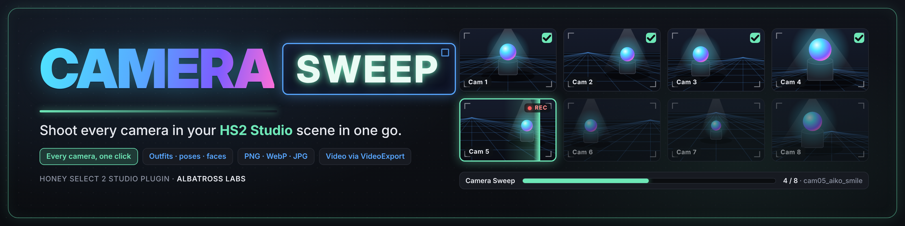

<p align="center"></p>

# Camera Sweep (HS2 Studio)

BepInEx plugin for Honey Select 2 Studio (StudioNEOV2). Set up a scene and cameras, press one key, and get a render of every camera. Add characters and choose what changes for each one (outfits, clothing states, expressions, face extras, swapping in other characters), and every camera is shot for every combination.

## Use

- **Ctrl+F10** runs a sweep. **Esc** cancels after the current shot; the scene is put back either way.
- The window uses the VN Deck look: dark panels, neon mint borders on the window, open characters and selected choices, blue titles and fold-out headers, and a solid mint Capture button. Colours live in `src/UI/Theme.cs`.
- **Shift+F10**, or the camera icon on Studio's left toolbar (it asks for the bottom row; drag it elsewhere in KKAPI's toolbar edit mode if you like), opens the window. It follows the order you set up a shoot:
  - **Still images / Video** at the top.
  - **1 Cameras**: a grid of camera buttons, 4 across. Click to turn one on or off, right-click to look through it. *Show all* if there are more than 12.
  - **2 Characters**: *+ Add character* (or *+ Add selected*), then tick the variations for that character. Add more characters if you want them to change too.
  - **3 Image** (or **Video**): format, size (*Screen / 1080p / 1440p / 4K*, **↔** for portrait), upsampling (1×–4×), transparency; *Advanced* holds the engine, WebP effort, shadows, ambient occlusion and settle frames.
  - **4 Files**: output folder, file-name template with a live example.
  - The footer always stays on screen: warnings (no cameras on, a variation with nothing to cycle, not enough disk space...), the image count, size and time, **Test shot** (one image of the current view with the current settings, into `test\` in the output folder) and the **Capture** button.
  - Sections fold up to a one-line summary; the window scrolls if it's taller than the screen.
  - Still images are shot with blinking and breathing paused on every character (breathing comes from AdvIK, if installed), so no shot has half-closed eyes or a chest mid-breath. Both go back to how they were when the sweep ends or is cancelled. Toggle in *Image > Advanced* (F1 > *Pause blinking and breathing for stills*). Video is left alone.
  - With **Studio Theme** (0.16.8+) and the **Graphics** plugin, each camera or numbered view can have its own Graphics preset (Studio Theme's camera menu, or right-click a view number). The sweep shoots each camera with its preset, so one run covers a day camera and a night camera, then puts back the Graphics settings you had before. Toggle: *Image > Advanced* › *Use each camera's Graphics preset* (F1 › *Use camera Graphics presets*).
  - During a sweep a progress bar with *Cancel* sits at the bottom of the screen. Studio has to switch to each camera to render it - that's also what makes characters set to look at the camera look at each one - so you see the view jump. F1 > *Cover the screen while capturing* hides that behind a full-screen progress screen instead (off by default). Captures render off-screen, so neither is ever in the images.
  - Selected choices, the Capture button and the progress bar use the Albatross Labs accent colour (`src/UI/Theme.cs`).
- Every setting is also in **F1** (Configuration Manager) under *Camera Sweep*.

**Camera sources**
- *Slots*: the 10 numbered camera buttons, plus MoarCamz's extra slots (11+) when MoarCamz is installed. Slots still holding the default view, cleared slots, and duplicates of an earlier slot are skipped (toggle in the window). MoarCamz lock-on slots are shot from their saved position; lock-on is not re-engaged.
- *Objects*: cameras added with Add > Camera. Named cameras use their name in the filename.
- *Both*: all of the above.

**Turning cameras off**: the window lists every camera it found with a tick box. Untick a camera and the sweep skips it. *All on* ticks them all again. The choices are saved in the scene file, so each scene keeps its own list. Saved views show as *Cam 1*-*Cam 10* (`cam01`... in file names) and camera objects by name (`cam_Name`); naming camera objects in the workspace makes them easier to tell apart.

**Output folder**: `UserData/cap/CameraSweep/<yyyyMMdd-HHmmss>/` by default, one folder per run (*Folder per run* off writes straight into the output folder and never overwrites existing files).

**File names** come from a template, set in the window or F1 (*Output > File name template*). The window shows an example of the first file name as you type.

| Token | Value |
|---|---|
| `{prefix}` | the *File prefix* box |
| `{scene}` | name of the scene file last loaded or saved (`untitled` for a new scene) |
| `{camera}` | `cam03` (saved view 3), `cam_Name` (camera object) |
| `{n}` | shot number in this run, zero-padded (`001`) |
| `{date}` `{time}` | when the run started (`20261112`, `235501`) |
| `{character}` | the first character in section 2 (their current name, so a swapped-in card's name while swapping) |
| `{characters}` | every character in section 2, e.g. `Aiko_Kenji` |
| `{swap}` `{outfit}` `{pose}` `{clothes}` `{face}` `{extras}` | the current value of that variation (card or preset name). When several characters use the same variation: `Aiko-smile_Kenji-grin` |
| `{axes}` | every variation in use as `outfit-casual_face-smile` (with several characters: `Aiko-face-smile_Kenji-face-grin`) |

A token for a variation that's off is left out and the separators around it are tidied (`a__b` becomes `a_b`). `/` makes subfolders. Default: `{prefix}_{axes}_{camera}`. A Ren'Py-style example: `{character}/{character}_{outfit}_{face}`. Names that would repeat get `_2`, `_3`.

## Capture engine and image format

The window's **Engine** switch picks who renders the image:

- **Screencap**: BepisPlugins Screencap's render shot (r19.x and r20+ supported). Needs Screencap installed.
- **Camera Sweep** (default from 0.9.4): Camera Sweep's own renderer, no Screencap needed. In the 1.0 test pass it matched Screencap with an opaque background and gave cleaner hair edges with a transparent one. It renders Studio's camera offscreen at *Size × Upsample* with no UI, scales depth-of-field blur to the render size, can turn ambient occlusion off when upsampling (it bands), and shrinks upsampled renders back on the GPU (exact 2× steps; a 3× factor is averaged on the CPU). **Transparency** uses two renders: one with all effects over black for colour, one without post-processing for alpha. The colour is then divided by the alpha, so hair and soft edges keep their own colour instead of a dark or background-coloured fringe.

Settings from before 0.9.4 that were on Screencap are switched to Camera Sweep's renderer once. If Screencap is selected but not installed, Camera Sweep's renderer is used. Screencap is an optional dependency: Camera Sweep loads and works without it.

**Compare engines** (*Image > Advanced*, when Screencap is installed): shoots the current view once with each engine into `test\` (`..._screencap` and `..._camerasweep`) so you can check they match before switching.

Both engines get the **shadow overrides** (F1 > *Render*: shadow map resolution, default 8192; cascades, default 4). Screencap applies these only to its own F11 shots, so before 0.7 Camera Sweep's shots had the game's normal shadow quality.

**Size**: type a width and height, or pick *Screen* / *1080p* / *1440p* / *4K* (the matching one is highlighted). **↔** swaps width and height for portrait shots (e.g. 1080×1920 VN sprites), and presets keep whichever orientation you're in. *Upsample* buttons: 1×–4×. Below them the window shows the file size in pixels and the size it's rendered at (e.g. *Saves 3840×2160, rendered at 7680×4320 (2×)*), in orange for very large renders and red past the GPU's limit. Older settings of 0 ("use Screencap's") are turned into real numbers the first time the window opens. Also in F1 > Output.

**Format**:

| Format | What you get |
|---|---|
| PNG | Lossless, opens anywhere. Largest files. |
| WebP | Lossless, usually 25–40% smaller than PNG, keeps transparency. Ren'Py and browsers read it. |
| WebP lossy | Much smaller (often 10× or more), keeps transparency. *Quality* sets how much detail is kept. |
| JPG | Small, no transparency (saved with the background). |

*Effort* (WebP) trades speed for size: 0 is fastest; lossless goes to 9, lossy to 6. Past about 4 the gain is a few percent for a lot more time.

WebP uses Google's **libwebp 1.4.0** (BSD licence), shipped as `libwebp_cs.dll` next to the plugin together with its licence. If that file is missing, WebP falls back to PNG with a message.

**Speed**: images are compressed on background threads. The sweep moves to the next camera while the last image is still saving, with at most two waiting. A run reports "done" only after every file is written.

## Video mode

Switch **Output** to *Video* in the window (or *Video > Output mode* in F1). Each camera then gets a video of one character's animation instead of a still.

- **Character**: the arrows pick a character in the scene; by default it uses whatever character is selected in the workspace when you start.
- **Cycles**: how many loops of that character's current animation each video lasts (fractions allowed).
- **Prewarm**: loops played before recording starts, so physics settles and every video starts exactly on a loop boundary. Videos loop cleanly.

Recording is done by the **VideoExport** plugin (included in BetterRepack). Camera Sweep selects the character, temporarily sets VideoExport to "Limit by: Animation" with your cycle counts, records, puts VideoExport's own settings back, and moves the finished video into the run folder as `<prefix>_<variations>_<camera>.mp4`. Framerate, format (MP4/WebM/GIF/AVI), quality and resize are VideoExport's settings: the **VideoExport settings** button in the Video section opens its window, and it opens by itself while recording so you can see the frame count and ETA. Videos are always opaque: VideoExport takes transparency from Screencap's own setting, so Camera Sweep turns that off while it records and puts it back afterwards.

VideoExport locks the game clock to the video framerate while recording, so motion is smooth no matter how slow each frame renders. The animation must be playing (not paused) when you start. Esc cancels after VideoExport stops the current recording.

Variations work in video mode too: e.g. 3 cameras x 2 outfits = 6 videos.


## Characters and variations

Variations belong to a character. Add a character in section 2, then tick what should change for them:

| Variation | What it does | Settings |
|---|---|---|
| Character swap | Replaces this character with each picked character card, in the same place and pose (Studio's own *Change character*). *Also shoot the original* (on by default) adds a no-swap shot first, named `original` in `{swap}`. The original is saved to a temporary card first and put back afterward. Cards of the other sex are skipped | Picked in Studio's character list (see *Picking files* below) |
| Outfits | Loads each picked outfit (coordinate card) the way Studio's Costume list does, so outfit plugin data (overlays, extra accessories) comes along. *Also shoot the outfit they're wearing now* adds it first as `original` (with a character swap, that's each swapped-in card's own outfit). The outfit worn at the start is saved with every plugin's data and put back afterwards | Picked in the character's Costume list, which opens by itself |
| Poses | Loads each picked Studio pose file (animation, FK/IK) the way the Pose list does. The pose they were in is captured first and put back afterward. *Also shoot the pose they're in now* adds it first as `original` | Picked in the Pose list |
| Clothing states | On / half / off per clothing part. Each preset starts from how the character was dressed when the sweep began | Grid of buttons: click a cell to cycle `-` (leave as it was) → On → Half → Off. Columns: Top, Bra, Bottom, Panties. Defaults: *dressed*, *half* (bra and panties half, top and bottom off), *topless*, *bottomless*, *nude*. A bra or panties set to Half or Off takes a top or bottom left at `-` off too, so the underwear shows. *Also shoot them as they're dressed now* (on by default) adds the unchanged state first as `original`. Rows with every part at `-` aren't shot. *All parts* adds gloves/pantyhose/socks/shoes on a second line |
| Expressions | Eyebrow, eye and mouth presets | `<` `>` step through the game's own face patterns for the character's sex and wrap around (past the last goes back to the first). **Set** copies the face the character has right now into that row. Defaults: *neutral* (0/0/0), *smile* (1/1/1), *ahegao* (11/11/17). Rows left all `-` aren't shot. Mouth patterns go through Studio's own setter, which switches the mouth-shape sliders off for the open/tongue patterns like the Face panel does |
| Face extras | Blush, tears, where the eyes and head look, eye opening, mouth opening | `<` `>` steppers, two lines per preset. Blush, tears and opening go 0 to 1 in 0.25 steps; eye/head look are the position in Studio's list. *+ From current* copies the character |

**Picking files** (swap, outfits, poses): press **+ Pick in Studio's list**. Studio's character list, the character's Costume tab or the Pose list opens, a banner appears at the bottom of the screen, and until you press **Done** (or Esc), the Load / Change button of Studio's own list adds the selected file to Camera Sweep instead of loading it. With **Studio Browser** 0.23 or later, its Character, Outfit and Pose browsers pick too (they open the way you've set them to open with Studio's lists): double-click, Enter or **Add to Camera Sweep** adds the selected cards, and **Add all shown** adds everything the browser shows with your folder, search and tag filters. Pick as many as you like. **Add all in this list** takes everything the list you last clicked in is showing (with Browser Folders, the current folder). Nothing has to be moved or reorganised, and anything that improves those lists (Browser Folders, Studio Character Sort, search plugins) works here too. Where to look:
- character cards: *Add > Character > Female / Male* (the banner tells you which);
- outfits: the character's *Anim > Costume* list (Camera Sweep selects the character for you);
- poses: the *Pose* list (Camera Sweep opens it for the character).

Lists show each file with an *x* to remove it, and *Clear*. Scenes from 0.8 that used a folder keep it as a `[folder]` entry.

Each character keeps their own settings, saved with the scene. New characters start from the defaults in F1 (*Axis: ...* sections); *Save as default* in a variation makes that character's presets the default for characters you add later, and *Reset* loads the defaults back.

**One character** (the usual case): shots per camera = that character's values multiplied together, e.g. 6 outfits × 3 expressions = 18.

**Several characters**: every combination. Aiko with 3 expressions and Kenji with 3 expressions = 9 shots per camera (each of Aiko's faces with each of Kenji's). The Characters section shows the multiplication, and the footer warns when a run gets large or won't fit on the disk.

Loop order, outer to inner: swap → outfit → pose → clothing state → expression → face extras (each across characters), then cameras. Slow changes like outfits and swaps load as few times as possible; when one changes, that character's inner variations are re-applied.

**Estimate**: the footer shows how many images (or videos) the current settings make, with the breakdown (`3 cameras × 18 variations`, or `3 cameras × Aiko 3 × Kenji 3`), total size and time, and free space on the output drive. The first numbers are rough guesses; after each sweep Camera Sweep records your real bytes-per-pixel (per format, with and without transparency) and seconds-per-shot (F1 > *Stats (measured)*) and uses those, scaled for resolution and upsampling changes. Video estimates appear after your first video sweep.

### Adding an axis (time of day, pose, lighting...)

1. Create `src/Axes/YourAxis.cs` implementing `IVariationAxis`, with a constructor `(OCIChar character, AxisStore store)`: `Prepare()` snapshots current state and returns the values, `Apply()` sets one, `Restore()` puts the snapshot back. Keep settings in `store` (`store.Bool`, `store.Text`) so they're saved with the scene.
2. Add its name to `CharacterPlan.Kinds` (position = nesting order) and a line to `CharacterPlan.Create`.

A variation that isn't about a character (time of day, lighting) would sit outside CharacterPlan; the runner's dimension list is the place to add it.

Runner, filenames, window and restore all pick it up automatically. For time of day: open `Assembly-CSharp.dll` in dnSpy, find what the Studio map/sun panel calls when you change it, and call that from `Apply()`.

## Build

Requires the .NET SDK (6 or newer). References come from the IllusionMods/BepInEx NuGet feeds in `nuget.config`, so you don't need to point at `StudioNEOV2_Data\Managed`.

v0.9.2 is built against the updated install: BepInEx 5.4.23.5, Modding API (HS2API) 1.48, Screencap 21.1.4, VideoExport 2.1.1. It also supports Screencap 19.x.

`libwebp_cs.dll` is built from `native/` (libwebp 1.4.0 + `cs_webp.c`, a three-function wrapper) with `native/build-libwebp.sh`, which cross-compiles a 64-bit Windows DLL with Zig from Linux or WSL. The build copies it next to the plugin.

```
dotnet build -c Release
```

Output: `bin\Release\HS2CameraSweep.dll`. The project's `HS2Dir` is set to `X:\HS2 RX15`, so every build also copies the DLL to `X:\HS2 RX15\BepInEx\plugins\AlbatrossLabs\HS2CameraSweep\`, and a Release build keeps a copy in `bin\Releasev<version>\`. Point it elsewhere with `-p:HS2Dir="D:\Other\HS2"`, or `-p:HS2Dir=` to skip the copy.

Requires HS2API (KKAPI for HS2) in the game, which BetterRepack includes. Screencap is optional.

Install = `HS2CameraSweep.dll`, `libwebp_cs.dll` and `LICENSE-libwebp.txt` in `BepInEx\plugins\AlbatrossLabs\HS2CameraSweep\` (0.9.6 and earlier used `BepInEx\plugins\HS2CameraSweep\`; delete that folder when updating).

## Release

Run `release.bat` (it calls `scripts/release.ps1`). It works like VN Deck's: nothing goes public until you press *Publish* on GitHub.

1. Asks for the version (Enter keeps the one in `src/CameraSweepPlugin.cs`; a new one is written there and in the csproj).
2. Stops if that version is already published on GitHub.
3. Opens `release-notes.md` in Notepad. Check it, save, close. Empty headings are left out; it stops if there are no entries.
4. Builds with `dotnet build -c Release` (without copying into the game). Without the .NET SDK, or with `release.bat -NoBuild`, it packages the DLL installed in `X:\HS2 RX15`, after checking that it's the version being released.
5. Zips into `releases\HS2CameraSweep-vX.Y.Z.zip` (ignored by git). Extracting it into the HS2 folder puts everything in `BepInEx\plugins\AlbatrossLabs\HS2CameraSweep\`: the DLL, `libwebp_cs.dll`, libwebp's licence files, `README.txt` (from `packaging/README.txt`) and `CHANGES.txt` (this version's notes).
6. Uploads a **draft** release `vX.Y.Z` to AlbatrossLabs/HS2CameraSweeper with the notes, install line, the zip and its SHA-256, then opens the Releases page.
7. Saves the notes to `docs/releases/X.Y.Z.md` and `CHANGELOG.md`, and empties `release-notes.md` for the next version.

Then commit and push in GitHub Desktop (version bump, changelog, notes), and press *Publish release*: GitHub makes the tag from `main` at that moment.

One-time setup: a fine-grained token at <https://github.com/settings/personal-access-tokens/new> (resource owner AlbatrossLabs, only HS2CameraSweeper, *Contents: Read and write*), then `setx GH_CameraSweep "github_pat_..."` and open a new window.

Release notes are written as the code changes: one line per change under ADD, CHANGE, REMOVE or FIX in `release-notes.md`.

## Dev tips

- **ScriptEngine** (BepInEx.Debug): drop the DLL in `BepInEx\scripts` and press Ctrl+Del in Studio to reload without restarting. Each reload may add another toolbar icon; the hotkeys are the reliable way to test.
- **RuntimeUnityEditor**: inspect `Studio.Studio.Instance` live (`sceneInfo.cameraData`, `dicObjectCtrl`, `ociCamera`).
- Log: `BepInEx\LogOutput.log`. On-screen messages come from `Logger.LogMessage`.

## Known limits

- Coordinate cards are sex-specific; each character's folder should hold cards for their sex.
- Scenes saved with 0.7 or earlier: camera on/off choices carry over, but the old character ticks don't. Add the characters again in section 2.
- Not every garment has a half state. A preset that asks for half on one that doesn't leaves that part as it was and logs a message, rather than letting the game jump it to off.
- One-piece outfits are linked by the game: taking the top off also takes the bottom off.
- Character swap restores the original from a card it saves at the start (in `BepInEx\cache\CameraSweep`, deleted afterward). Plugin data that isn't stored on character cards (e.g. some Studio-only per-character settings) may not survive the round trip.
- `{scene}` only knows scenes loaded or saved while Camera Sweep is running; a scene loaded before the plugin started shows as `untitled` until you load or save again.
- Studio animation or other plugins that drive the face every frame can override expression presets. Pause animation if faces don't stick.
- Camera Sweep's renderer is new in 0.7 and hasn't been compared shot-for-shot with Screencap yet. If something looks off, switch the engine back to Screencap and tell us what differs.
- Transparency only removes the camera background. A map or other 3D object behind the characters stays (same as Screencap).
- If Studio's camera hasn't fully settled (heavy DOF, physics), raise *Settle frames* in F1.

## Source map

```
src/CameraSweepPlugin.cs      entry point, config, hotkeys, toolbar button
src/Sweep/SweepRunner.cs      the loop: axes × cameras, snapshot + restore
src/Sweep/CameraShots.cs      saved-slot and camera-object shots, unset-slot detection
src/Sweep/MoarCamzSlots.cs    MoarCamz extra slots (reflection, optional)
src/Sweep/SweepSelection.cs   camera on/off and the characters in the sweep, saved with the scene
src/Sweep/CharacterPlan.cs    one added character and their own variations
src/Axes/AxisStore.cs         per-character variation settings; defaults in F1
src/Sweep/Estimate.cs         image count, size and time estimate; learns from each run
src/Sweep/NameTemplate.cs     file-name template, {scene} capture
src/Axes/CharacterSwapAxis.cs character swap
src/Axes/FaceExtrasAxis.cs    blush, tears, eye/neck look, eye/mouth opening
src/Capture/ScreencapBridge.cs  reflection bridge to Screencap r19 / r20+
src/Capture/ShotWriter.cs     capture: engine choice, GPU readback, hands off to the encoders
src/Capture/BuiltInRenderer.cs  Camera Sweep's renderer (size, upsampling, DOF, AO, transparency)
src/Capture/RenderOverrides.cs  shadow resolution/cascades, ambient occlusion, DOF (reflection)
src/Capture/PixelProcessor.cs   flip, alpha combine, CPU downscale (worker thread)
src/Capture/PngEncoder.cs     PNG writer usable off the main thread
src/Capture/WebpEncoder.cs    libwebp_cs.dll loader and WebP writer
src/Capture/EncodeQueue.cs    background saving, main-thread steps (JPG)
native/                       libwebp wrapper source and build script
src/Capture/VideoExportBridge.cs  drives VideoExport per camera (reflection, optional)
src/Axes/*.cs                 variation axes
src/UI/SweepWindow.cs         the window (sections, footer, warnings)
src/UI/PickMode.cs            picking files with Studio's own lists (Harmony hooks + banner)
src/UI/Theme.cs               Albatross Labs colours (accent hex values at the top)
src/Axes/CardList.cs          a picked list of cards / poses
src/Axes/PoseAxis.cs          poses
src/UI/*.cs                   generated toolbar icon, layout helper
```
